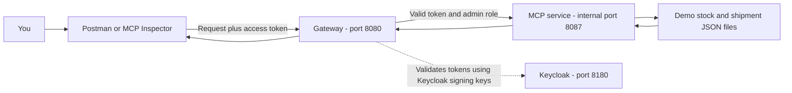
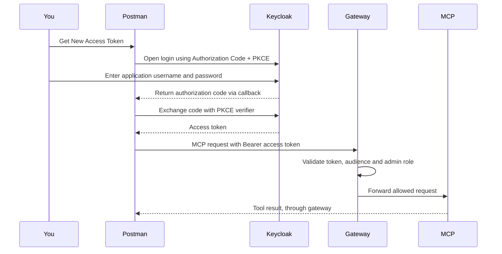

# Understanding our MCP setup

## 1. What are we trying to do?

We want an application or an AI assistant to answer questions such as:

- How many Logitech G Pro units do we have in stock?
- How many units do we still have to send to customers?
- Do we have enough stock to cover those shipments?

We created an **MCP server** that provides tools for retrieving those quantities.
For now, the quantities come from **demo JSON files**, not the real inventory or
customer order databases.

MCP means **Model Context Protocol**. It gives clients a standard way to discover
and call tools exposed by a server.

## 2. The four parts you need to understand

| Part | Its purpose in this project |
| --- | --- |
| MCP service | Provides the stock and pending-shipment tools. Runs in Docker on internal port 8087. |
| Gateway | The public entry point. Checks access tokens and permissions, then forwards allowed requests to MCP. Runs on port 8080. |
| Keycloak | Handles user login and issues access tokens. Runs on port 8180 in our development setup. |
| Postman or MCP Inspector | A client used to connect to the server and test its tools. |

**The MCP service is not a chat interface and does not run an AI model.**
Inspector can display prompts and call tools manually. An AI application can use
the same tools to produce conversational answers.

## 3. How requests travel



If your Markdown viewer does not render Mermaid diagrams, the flow is:

```text
Postman / Inspector
        |
        | Authorization: Bearer <access-token>
        v
Gateway: http://localhost:8080/api/mcp
        |
        | Checks the token and the user's admin role
        v
MCP container: http://mcp-service:8087/api/mcp
        |
        v
Demo data -> tool result -> gateway -> client
```

`localhost` means the computer running the client. After deployment, clients use
the deployed gateway's address instead. Inside Docker, `mcp-service` is the
service name that the gateway uses to find the MCP container.

## 4. Why do we need the gateway?

The gateway controls who can access the MCP tools.

For `/api/mcp`, it requires:

1. A valid access token issued by our Keycloak realm `ecommerce`.
2. The expected token audience: `ecommerce-api`.
3. The realm role `admin`.

The gateway checks the token rather than asking you to enter a password for
every tool call. Keycloak handles the login; the gateway handles access to the API.

| Request | Expected gateway behavior |
| --- | --- |
| No access token | 401 Unauthorized |
| Invalid or expired token | 401 Unauthorized |
| Valid token without the admin role | 403 Forbidden |
| Valid admin token | Request is forwarded to MCP |

Our MCP service itself does not currently validate access tokens. That is why
clients must go through the gateway.

## 5. What we changed, and why port 8087 changed several times

We first tested the MCP service directly to confirm that its tools worked.
During troubleshooting, we temporarily started a native Java instance. That
instance was stopped when we switched back to Docker.

We then temporarily published the Docker service's port so Inspector could
connect directly. An extra file, `compose.mcp-inspector.yaml`, initially held
that configuration. We later removed that file and moved the mapping into the
main `compose.yaml`.

The mappings meant:

| Docker configuration | Meaning |
| --- | --- |
| `127.0.0.1:8087:8087` under `ports` | Direct access from this computer only |
| `8087:8087` under `ports` | Direct access through all host network interfaces |
| No `ports` mapping for MCP | No direct host access; clients use the gateway |

Both published mappings bypassed gateway authentication. That explains why
Inspector could connect without logging in.

**The final configuration removes the MCP port mapping.** The MCP service still
listens on port 8087 inside Docker, but it is not published on your computer.
The gateway can reach it through the Docker network.

Docker Desktop may still display `8087/tcp` for the container. That means the
container has an internal port; it does not mean that `localhost:8087` is open.
There should be no `0.0.0.0:8087->8087` host mapping.

The remaining `expose: ["8087"]` documents the internal port. It does not publish
the port on the host and is not an authentication mechanism.

## 6. The addresses to use now

| Address | Use |
| --- | --- |
| `http://localhost:8080/api/mcp` | Connect Postman or Inspector through the gateway |
| `http://localhost:8180` | Keycloak login and administration |
| `http://mcp-service:8087/api/mcp` | Internal address used by the gateway container |
| `http://localhost:8087/api/mcp` | No longer accessible directly from the host |

The MCP endpoint includes **`/api/mcp`**. Opening just a server's root address
does not show a dashboard. An MCP request also requires the protocol handshake;
use an MCP client to handle that automatically.

## 7. Login and access tokens, in simple terms

An access token is a temporary credential that says who you are and what roles
you have. You obtain it by logging in to Keycloak.



Postman handles the code exchange and PKCE details for you. The callback URL is
the address used to return the login result to Postman. Keycloak must allow that
exact callback URL for the client.

Two different accounts are involved in the development setup:

| Account | Where it is used | Default credentials |
| --- | --- | --- |
| Keycloak administrator | Keycloak administration console, to configure clients | `admin` / `admin`, unless overridden in the environment |
| Application demo administrator | The ecommerce login page, to obtain a token for MCP | `admin.demo@ecommerce.test` / `demo1234` |

The application demo account is not the administrator of Keycloak itself.
These are development credentials, not deployment credentials.

## 8. Get an access token with Postman

### A. Configure Postman

Create a request in Postman and open **Authorization**. Select **OAuth 2.0**, then
find **Configure New Token**.

| Setting | Value |
| --- | --- |
| Grant Type | Authorization Code (With PKCE) |
| Authorize using browser | Enabled |
| Auth URL | `http://localhost:8180/realms/ecommerce/protocol/openid-connect/auth` |
| Access Token URL | `http://localhost:8180/realms/ecommerce/protocol/openid-connect/token` |
| Client ID | `web-bo` |
| Client Secret | Leave empty |
| Code Challenge Method | SHA-256 |
| Scope | `openid profile email` |
| Client Authentication | Send client credentials in body |

Copy the exact **Callback URL** displayed by your Postman version.

### B. Allow the callback in Keycloak once

1. Open `http://localhost:8180` and enter the administration console.
2. Log in with the Keycloak administrator account.
3. Select the **ecommerce** realm.
4. Open **Clients → web-bo → Settings**.
5. Add Postman's exact callback URL to **Valid redirect URIs**. Keep the existing
   back-office URI as well.
6. Save.

This is a required configuration step unless you have already completed it.
We have not verified that your running Keycloak client has this callback saved.
An administration-console change updates the running Keycloak database; it does
not automatically update the repository's realm import JSON.

### C. Log in and retrieve the token

1. Return to Postman and click **Get New Access Token**.
2. On the ecommerce login page, use `admin.demo@ecommerce.test` / `demo1234`.
3. Complete the login and return to Postman.
4. Postman displays the token. Click **Use Token**, or copy the **Access Token**
   to use in Inspector.

Use the access token, not the ID token or refresh token. Access tokens expire
after five minutes by default in this realm.

Our client has password grants disabled. Sending a username and password directly
to the token endpoint with `grant_type=password` will not work with this setup.

### Why your earlier request returned 400

Keycloak logged:

```text
Parameter 'client_id' not present or present multiple times
```

The authorization request lacked a single valid `client_id`. Set **Client ID**
to `web-bo` in Postman's OAuth configuration, keep the Auth URL free of manually
added query parameters, and click **Get New Access Token**. Sending a regular
request to the bare `/auth` URL does not start a complete OAuth flow.

## 9. Demonstrate MCP authentication and tools

Start the containers if needed:

```powershell
docker compose --profile services up -d mcp-service api-gateway
```

Then perform this demonstration:

1. Open an MCP request in Postman, or open MCP Inspector.
2. Choose **Streamable HTTP**.
3. Enter `http://localhost:8080/api/mcp`.
4. Connect without a token: the gateway should return **401**.
5. Obtain an application admin access token using the Postman steps above.
6. Add the token and reconnect:
   - In a **Bearer Token** field, paste only the token.
   - In a custom header, use `Authorization: Bearer <access-token>`.
7. Open **Tools** and call `get_product_stock` with:

   ```json
   {"productName": "Logitech G Pro"}
   ```

   Expected demo stock: **24 units**.

8. Call `get_pending_shipments` with the same input.
   Expected result: **7 units still to send across 2 orders**, with remaining
   quantities of **3** and **4**.
9. Explain that the example stock balance is `24 - 7 = 17` units after those
   shipments. This calculation does not model reservations or live inventory.

To demonstrate role restrictions too, obtain a token for the development account
`client.demo@ecommerce.test` / `demo1234`. It has no admin role, so the gateway
should return **403**. Ensure the browser signs into that account rather than
reusing an existing admin login session.

## 10. What the tools and prompts do

| Type | Name | Purpose |
| --- | --- | --- |
| Tool | `get_product_stock` | Returns demo product stock |
| Tool | `get_pending_shipments` | Returns demo remaining shipment quantities and order breakdown |
| Prompt | `product_stock` | Instructions for answering a stock question |
| Prompt | `pending_shipments` | Instructions for answering a pending-shipment question |
| Prompt | `stock_coverage` | Instructions for comparing stock with pending shipments |

A **tool** executes code and returns data. A **prompt** returns reusable
instructions for an AI client. Retrieving a prompt in Inspector does not itself
run an AI model or automatically answer the question.

Pending shipments count only unshipped units in orders marked `IN_PREPARATION`.
NEW, CANCELLED, SHIPPED and DELIVERED orders are excluded from that total.

The demo files are:

- `mcp-service/src/main/resources/seed/product-stock.json`
- `mcp-service/src/main/resources/seed/product-shipments.json`

## 11. Common errors

| Error | What to check |
| --- | --- |
| Connection refused on 8087 | Expected: direct host access was removed. Use gateway port 8080. |
| 401 | Missing, expired or invalid access token; obtain a fresh application token. |
| 403 | Valid token but insufficient role, or a browser origin restriction. MCP requires admin. |
| 400 during login | Check Client ID, PKCE settings and the error from Keycloak. |
| Invalid redirect URI | Register the exact Postman callback under `web-bo`. |
| 404 | Check `/api/mcp`. After an MCP container restart, disconnect and reconnect to create a new session. |
| Empty tool list | Check that the MCP container runs with the `demo-stock` profile. |

## 12. What has been verified

- The MCP module's 17 tests passed after adding shipment tools and prompts.
- The Docker service returned the demo stock and shipment results.
- After removing the published MCP port, direct host access to 8087 failed as expected.
- The gateway returned 401 for an unauthenticated MCP request.
- The gateway container could reach the healthy MCP service internally.

Your successful Postman login and authenticated MCP connection still need to be
demonstrated. The earlier 400 was diagnosed from Keycloak logs; a successful
token exchange has not yet been observed in this session.

For deployment, the same architecture applies: expose the gateway with HTTPS,
keep MCP on the internal network, and configure Keycloak's deployed URLs and
credentials. The repository's Compose stack is currently a development setup.

Reference: [Postman's OAuth 2.0 configuration guide](https://learning.postman.com/docs/use/send-requests/authorization/oauth-20/).
